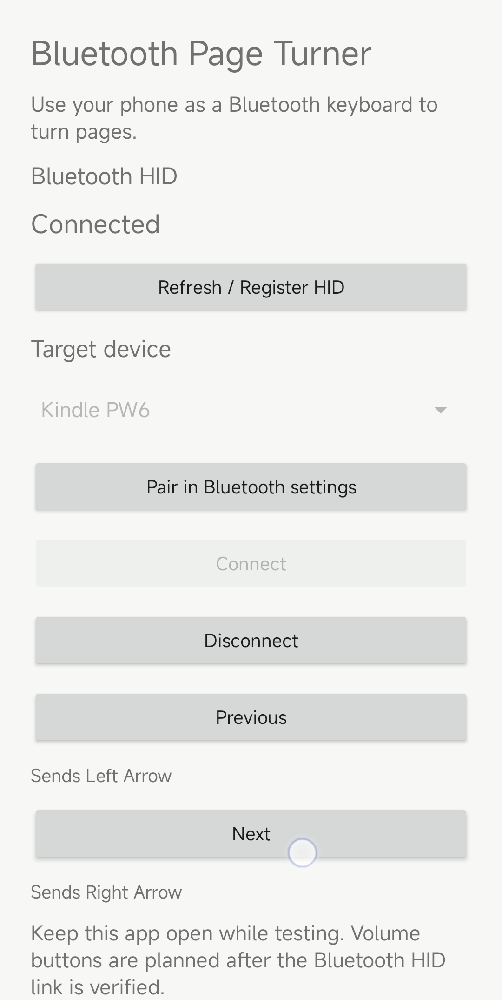
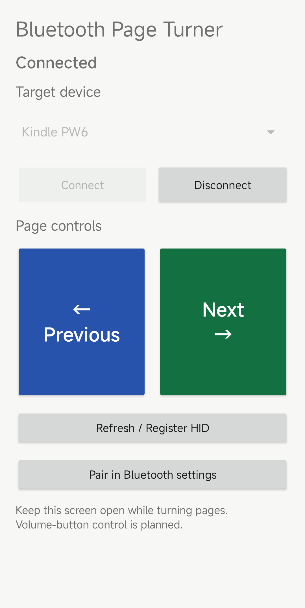

# Physical device validation

Validation date: **2026-10-14 (Asia/Shanghai)**. The tested Android app is the
`0.1.0-dev` debug build from commit [`13cfbda`](https://github.com/moreshuang/bluetooth-page-turner/commit/13cfbda).

The maintainer tested Bluetooth HID page navigation with a Xiaomi 13 and a Kindle
Paperwhite 6. Pairing, connection, and both page directions succeeded. The phone UI,
Android pairing record, and host status were captured during the session. Page-turn
behavior is reported by the maintainer; the screenshots show connection and pairing.

| Component | Tested configuration | Evidence source |
| --- | --- | --- |
| Phone | Xiaomi 13 (`2211133G`), Android 13, MIUI `V14.0.31.0.TMCCNXM` | ADB device and build properties |
| Android app | `0.1.0-dev`, commit `13cfbda` | Installed debug build and app UI |
| E-reader | Kindle Paperwhite 6, firmware `5.17.1.0.4` | Maintainer device record |
| Reader | KOReader `v2026.07.2` | Maintainer device record |
| Kindle HID host | Version `3.17.5-ba48659` | Local host status API |

## Procedure and results

1. Installed the Android debug build, granted Nearby devices permission, and opened
   the app in the foreground. The phone reported `HID ready`.
2. Paired the phone as a Classic Bluetooth HID device through the Kindle host's local
   API. The Mac forwarded local port `18321` to port `8321` on the Kindle. The pairing
   request used this form, with the actual phone address kept private:

   ```bash
   curl 'http://127.0.0.1:18321/pair?addr=<PHONE_BLUETOOTH_ADDRESS>&protocol=classic&name=Xiaomi13'
   ```

3. Android Bluetooth settings listed **Kindle PW6** as a saved device. The app selected
   that device and reported **Connected**. The phone's `HidManager` log recorded
   `Device connected` and a keyboard protocol change.
4. The Kindle host status API reported one configured device, one live connection,
   `daemon_running: true`, and `hid_ready: true`.
5. In a KOReader book, the maintainer pressed **Next** and **Previous** in the phone
   app and confirmed that the Kindle turned pages in both directions.
   Android logs also recorded `Send RIGHT_ARROW` and `Send LEFT_ARROW` during testing.
6. After visiting Android Bluetooth settings, the app was reopened and reconnected.
   The phone again reported **Connected**, and the Kindle host again reported
   `hid_ready: true`.

## Screenshots

The screenshots were captured from the Xiaomi 13 with `adb exec-out screencap -p`.
The app image has its Bluetooth address suffix obscured. The settings image is cropped
to the Kindle pairing entry; other paired devices and the phone's device name are
outside the published image.

**Connected Android app:**



**Android Bluetooth pairing record:**


## Stability observations and interface update

In a follow-up test on 2026-10-14, the maintainer confirmed that the app's **Connect**
and **Disconnect** controls worked. Leaving the app foreground disconnected the HID
session, consistent with the current Activity lifecycle. Foreground exit therefore
requires reopening the app and connecting again to resume page control.

The page controls were enlarged in a subsequent development build. On the Xiaomi 13,
each button measured approximately 200 dp high and occupied half the available row.
The buttons have distinct blue and green backgrounds, direction arrows, text labels,
and accessibility descriptions. The connected screen was captured with ADB after the
layout change. ADB taps on both controls logged `Send RIGHT_ARROW` and
`Send LEFT_ARROW`; the phone remained connected and the Kindle host reported
`hid_ready: true`.



## Follow-up validation

Repeat page navigation over a longer session, verify key release and recovery after
link loss, and measure power use before finalizing the first release. The connection
and page-navigation result above applies to the recorded devices and software versions.
