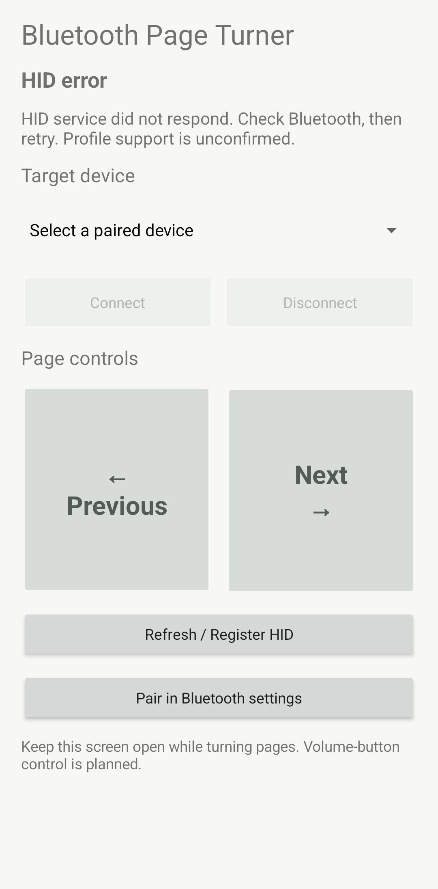
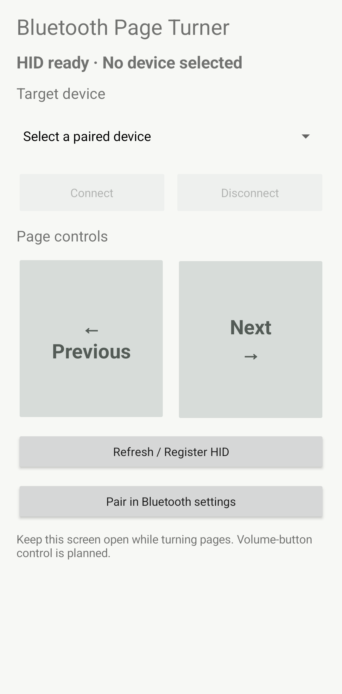
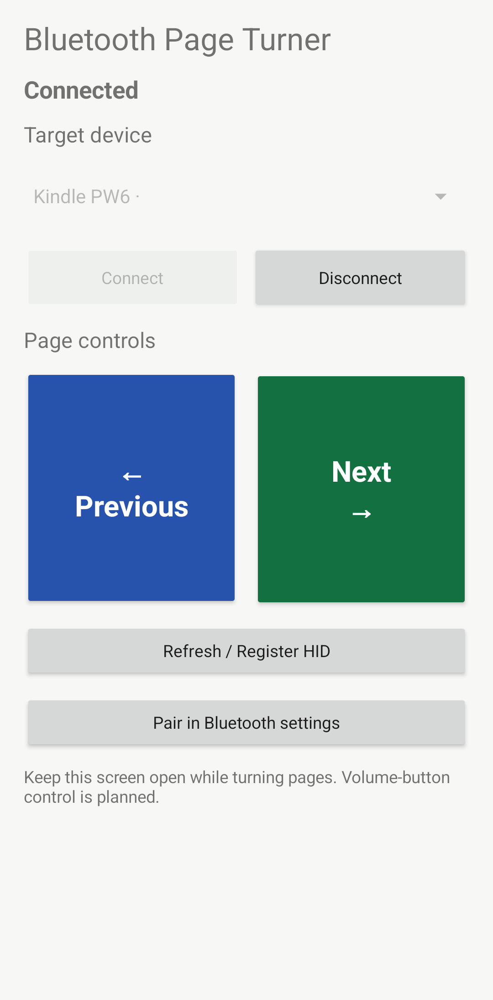

# LineageOS device validation

Validation date: **2026-11-16 (Asia/Shanghai)**.

A Xiaomi 13 running Android 16 and LineageOS 23.2 completed HID registration,
pairing with a Kindle Paperwhite 6, and page navigation in both directions. The
test used the existing `0.1.0-dev` debug APK after enabling the phone's HID Device
profile through a temporary system setting on the rooted test device.

## Environment

| Item | Recorded value |
| --- | --- |
| Phone | Xiaomi 13, model `2211133C`, codename `fuxi` |
| Android | 16 |
| LineageOS | `23.2-20261005-NIGHTLY-fuxi` |
| App source | Commit [`28c8ecc`](https://github.com/moreshuang/bluetooth-page-turner/commit/28c8ecc), `0.1.0-dev` |
| APK SHA-256 | `d14147b221f4336cea7200b72ec9127082ccb32cd1985a11b8b3b0404e337b06` |
| Installation and inspection | ADB over Wi-Fi |
| Host | Kindle Paperwhite 6; firmware recorded as `5.17.1.0.4` |
| Reading application | KOReader `v2026.07.2`, confirmed over SSH |
| Host HID integration | `3.17.5-ba48659`, confirmed through its local status API |

## HID service diagnosis

Before troubleshooting, Bluetooth was on and Nearby devices permission was granted.
The application displayed **HID error** with the message **HID service did not
respond**. The following observations located the issue before registration:

| Check | Initial observation | After the runtime setting and Bluetooth restart |
| --- | --- | --- |
| `bluetooth.profile.hid.device.enabled` | `false` | `true` |
| Enabled Bluetooth profiles | HID Host present; HID Device absent | HID Device present |
| Service dump | HID Device service absent | `Profile: HidDeviceService` present |
| Registration | Service acquisition timed out | Callback confirmed registration |
| Application | `HID error` | `HID ready · No device selected` |

The [LineageOS HID Device service](https://github.com/LineageOS/android_packages_modules_Bluetooth/blob/lineage-23.2/android/app/src/com/android/bluetooth/hid/HidDeviceService.java)
uses the HID Device profile property to decide whether the service is enabled.
The origin of the initial disabled setting remains a follow-up investigation for
this phone configuration.

For this rooted test phone, the operator applied a runtime property change and
restarted Bluetooth:

```bash
adb shell "su -c 'setprop bluetooth.profile.hid.device.enabled true'"
adb shell cmd bluetooth_manager disable
adb shell cmd bluetooth_manager wait-for-state:STATE_OFF
adb shell cmd bluetooth_manager enable
adb shell cmd bluetooth_manager wait-for-state:STATE_ON
```

These commands require root for the property change and restart Bluetooth. This
session tested the runtime setting; its state after a phone reboot is pending.
The application continued to use the public Android Bluetooth APIs.

## Pairing and input validation

The new Android installation initially had zero bonded devices. Its Bluetooth
Class of Device property was `90,2,12`, identifying it as a phone. The maintainer
reported an empty Kindle HID scan list. Pairing was then started through the
host's local API using the phone's current Bluetooth address:

```text
GET http://127.0.0.1:8321/pair?addr=<PHONE_BLUETOOTH_ADDRESS>&protocol=classic&name=Xiaomi13
```

The request ran over the authenticated Kindle SSH session. The API reported
**Paired successfully**, the phone displayed **Connected**, and both page controls
became available. The host status reported one configured device, one connection,
`hid_ready: true`, and a 65-byte HID descriptor.

The maintainer opened a book in KOReader and confirmed successful **Next** and
**Previous** page navigation. The phone log recorded `Send RIGHT_ARROW` and
`Send LEFT_ARROW`. The connection remained active during the subsequent status check.

## Screenshots and supporting evidence

All three images were captured from the phone with `adb exec-out screencap -p`.
System status and navigation bars are cropped. The connected image has the
Bluetooth address suffix obscured. Published logs and status omit device addresses,
local IP addresses, pairing codes, and authentication material.

**Initial service timeout:**



**Successful registration after the runtime setting:**



**Connected to the Kindle:**



Supporting records:

- [Sanitized HID lifecycle and input log](evidence/lineageos-2026-11-16/hid-lifecycle.log)
- [Sanitized host status](evidence/lineageos-2026-11-16/host-status.json)

## Follow-up checks

Verify behavior after reboot, identify the source of the initial profile setting,
and repeat connection and key-release checks over a longer reading session. Results
in this report apply to the recorded software and runtime configuration.
